<div dir="rtl">

# שעון מטריצה RGB – ESP32, WS2812 ולוח עברי

    

שעון על מטריצת לדים צבעונית WS2812, בגודל 8×32 או 8×64 (שתי מטריצות משורשרות).
ביום-יום הוא שעון נקי ויפה. כשרוצים, הוא הופך למרכז של מסיבה, צבעוני ובוהק.
השעון גולל תאריך עברי ולועזי, חגים, פרשת השבוע וזמני שבת, מתעמעם בלילה, ונשלט משלושה לחצני מגע, מדף אינטרנט שהוא עצמו מגיש, או מאפליקציה בטלפון דרך Bluetooth.

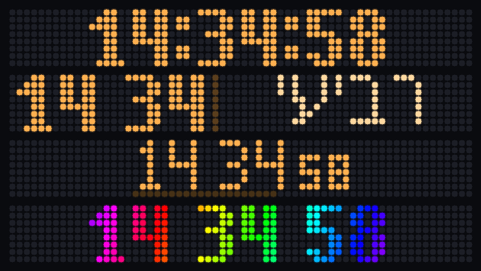

> **אפליקציית Bluetooth:** <https://amir684.github.io/esp32-matrix-clock/>. פותחים אותה ב-Chrome באנדרואיד ובוחרים "התקן אפליקציה".

> **על התמונות:** תמונות הצג אינן צילומים. הן נוצרו על ידי הקוד של הקושחה עצמו, שרץ על המחשב (ראו [כלים ובדיקות](#כלים-ובדיקות)), וצוירו נקודה מול נקודה.

## תוכן

- [מה השעון עושה](#מה-השעון-עושה)
- [חומרה וחיבורים](#חומרה-וחיבורים)
- [התחלה מהירה](#התחלה-מהירה)
- [הצג](#הצג)
- [הלחצנים](#הלחצנים)
- [משחקים](#משחקים)
- [דף ההגדרות](#דף-ההגדרות)
- [אפליקציית Bluetooth](#אפליקציית-bluetooth)
- [סידור המטריצה](#סידור-המטריצה)
- [שעה ורשת](#שעה-ורשת)
- [מבנה הקוד](#מבנה-הקוד)
- [הממשק (API)](#הממשק-api)
- [כלים ובדיקות](#כלים-ובדיקות)
- [מה נבדק ומה לא](#מה-נבדק-ומה-לא)

## מה השעון עושה

| נושא | מה יש |
|---|---|
| שעה | ארבעה סגנונות. שעה גדולה ומודגשת, שעה ושניות עם פס שניות, ספרות דקות, ושעה + מידע ל-8×64. שעון 24 או 12 שעות. נקודתיים מהבהבות |
| צבעים | 11 ערכות מוכנות. צבע אחד, מעבר בין שני צבעים, קשת נעה, או צבע שמשתנה לפי שעות היום. אפשר לצבוע את הנקודתיים בצבע נפרד |
| גלילת מידע | פעם בכמה זמן השעה מחליקה למעלה, ובמקומה נגללים, כל אחד בצבע משלו: יום בשבוע, תאריך עברי, תאריך לועזי, חגים וצומות, פרשת השבוע (ביום שישי), כניסת שבת וצאת שבת, ספירת העומר, טמפרטורה, זריחה ושקיעה, והודעה קבועה |
| לוח עברי | התאריך מתחלף בשקיעה ("ליל שישי"). ארץ ישראל או חוץ לארץ. בחירת עיר מתוך כ-70 ערים, או קואורדינטות ידניות |
| לילה | לפי שעות או מהשקיעה עד הזריחה. עוצמה נפרדת, צבע לילה רך (ברירת המחדל אדום כהה), או כיבוי מלא שנגיעה בלחצן מבטלת |
| מסיבה | 17 אפקטים. השעה מופיעה מעל האפקט בלבן עם מסגרת שחורה. בהירות, מהירות, החלפה אוטומטית וחזרה לשעון אחרי זמן |
| משחקים | סנייק, דינוזאור, פלאפי וטטריס על הצג, עם שיא לכל משחק. משחקים מהטלפון או בלחצני המגע |
| מטריצה | 8×32 או 8×64. כל סוגי סידור הלדים, סדר צבעים, הגבלת זרם לפי ספק הכוח, ושלוש בדיקות שעוזרות למצוא את ההגדרה הנכונה |
| שליטה | שלושה לחצני מגע, דף אינטרנט בעברית (גם בלי רשת ביתית), ואפליקציה מותקנת שעובדת דרך Bluetooth |
| שעה | DS3231 שומר את השעה גם בלי חשמל. בחיבור לרשת הבית השעה מגיעה מהאינטרנט ונכתבת גם ל-DS3231 |
| חיישן (לא חובה) | BME280: טמפרטורת החדר, לחות ולחץ אוויר בגלילה ובאפליקציה. גם BMP280 (בלי לחות). בלי חיישן, הטמפרטורה מגיעה מה-DS3231 |
| עדכון | עדכון קושחה מהדפדפן (OTA), גיבוי ושחזור של ההגדרות |

## חומרה וחיבורים

| רכיב | הערה |
|---|---|
| ESP32 DevKit V1 (ESP32-WROOM-32) | עם זיכרון פלאש של 16MB, או 4MB עם הסביבה `esp32-4mb` |
| מטריצת WS2812B, 8×32 | אחת או שתיים |
| DS3231 | מודול עם סוללה |
| BME280 (לא חובה) | מודול I2C של 3.3V, כתובת 0x76 או 0x77 (השעון מוצא לבד) |
| 3 × TTP223 | מודולי מגע. בלי לגעת בגשרים: יציאה פעילה בגבוה, לא נעולה |
| ספק 5V | כל לד מושך עד 60mA בלבן מלא, כלומר 15A ל-256 לדים. בפועל מגבילים בתוכנה |
| 74AHCT125 (מומלץ) | ממיר רמות מ-3.3V ל-5V לקו הנתונים |

| חיבור | פין ב-ESP32 |
|---|---|
| DIN של המטריצה | GPIO27, דרך נגד 330Ω |
| DS3231 SDA / SCL | GPIO21 / GPIO22, ו-VCC ל-3.3V |
| BME280 SDA / SCL | אותו חיבור: GPIO21 / GPIO22, ו-VCC ל-3.3V. כדאי להרחיק אותו מהלדים ומהבקר, שמחממים אותו |
| לחצן 1 / 2 / 3 (OUT של TTP223) | GPIO32 / GPIO33 / GPIO25, ו-VCC ל-3.3V |

- שתי מטריצות: DOUT של הראשונה ל-DIN של השנייה.
- את ה-5V של המטריצות מזינים ישר מהספק, לא דרך לוח ה-ESP32. ה-GND משותף לכולם. קבל של 1000µF על כניסת ה-5V.
- בלי ממיר רמות חלק מהמטריצות עובדות, וחלק מהבהבות או מציגות צבעים שגויים.
- הפינים מוגדרים ב-[`include/config.h`](include/config.h).

## התחלה מהירה

1. **בנייה וצריבה** (PlatformIO Core 6.2 ומעלה, הפלטפורמה pioarduino):

</div>

```
pio run -t upload               # 16MB flash
pio run -e esp32-4mb -t upload   # 4MB flash
```

<div dir="rtl">

2. **התחברות:** השעון פותח רשת אלחוטית בשם **MATRIX-CLOCK**. הסיסמה שלה רשומה על המדבקה בגב השעון (10 אותיות גדולות באנגלית וספרות). מתחברים אליה מהטלפון, ודף ההגדרות נפתח לבד. אם לא, גולשים ל-`192.168.4.1`.
3. **המטריצה:** בלשונית "מטריצה" בוחרים גודל, סידור לדים והגבלת זרם, ומריצים את הבדיקות. ראו [סידור המטריצה](#סידור-המטריצה).
4. **השעה:** בלשונית "שעה ורשת" לוחצים "כוון עכשיו". השעה נלקחת מהטלפון ונשמרת ב-DS3231.
5. **רשות:** חיבור לרשת הבית לכיוון שעה אוטומטי, והתקנת [אפליקציית ה-Bluetooth](#אפליקציית-bluetooth).

## הצג

**8×32:** שעה גדולה, שעה ושניות עם פס שניות, ספרות דקות, ומעבר בין שני צבעים.

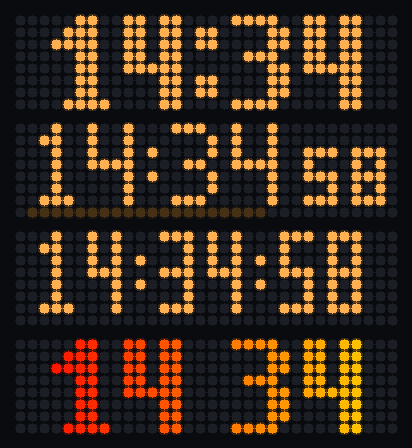

**8×64:** שעה מלאה, שעה + מידע (יום, תאריך עברי, טמפרטורה ותאריך לועזי מתחלפים בתיבה), שעה ושניות, וקשת.


**גלילת המידע** ביום רביעי: יום ותאריך עברי, תאריך לועזי, טמפרטורה. העברית נכנסת משמאל, כך שתחילת המשפט מגיעה ראשונה.

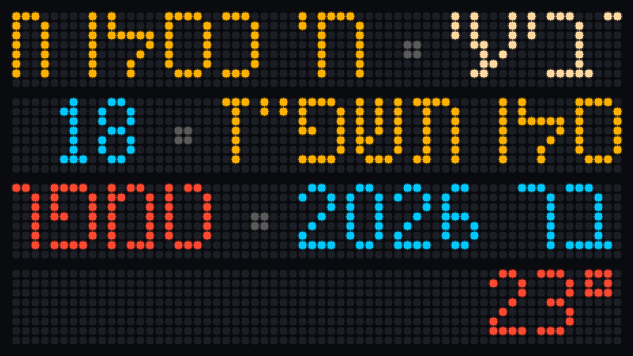

**ביום שישי** נוספות פרשת השבוע וזמני כניסת השבת וצאתה, ובשבת עצמה צאת השבת:

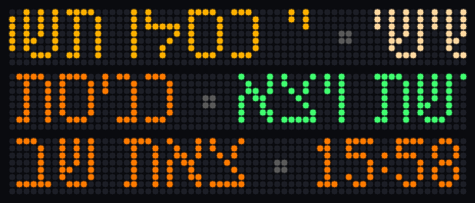

### אפקטי המסיבה

קשת, פלזמה, אש, גשם דיגיטלי, קונפטי, לבה, אוקיינוס, יער, מסיבה (רעש צבעוני), כוכבים, סורק, אקולייזר, מטאורים, פעימה, אדוות, זיקוקים, וטקסט חופשי בצבעי קשת.
אפשר לבחור אפקט אחד, או סבב של כולם שמתחלף כל כמה שניות.

## הלחצנים

| לחצן | לחיצה קצרה | לחיצה ארוכה |
|---|---|---|
| 1 | שעון ⇄ מסיבה | כיבוי / הדלקה של התצוגה |
| 2 | בהירות (5 דרגות; בלילה – דרגות לילה, במסיבה – בהירות המסיבה) | ערכת הצבע הבאה; במסיבה – האפקט הבא |
| 3 | גלילת התאריך עכשיו | הצגת כתובת הרשת של השעון |

כשהתצוגה כבויה בלילה, נגיעה בכל לחצן מדליקה אותה ל-15 שניות.

בזמן משחק הלחצנים משמשים לשליטה במשחק, ונגיעה ארוכה בלחצן 1 חוזרת לשעון.

## משחקים

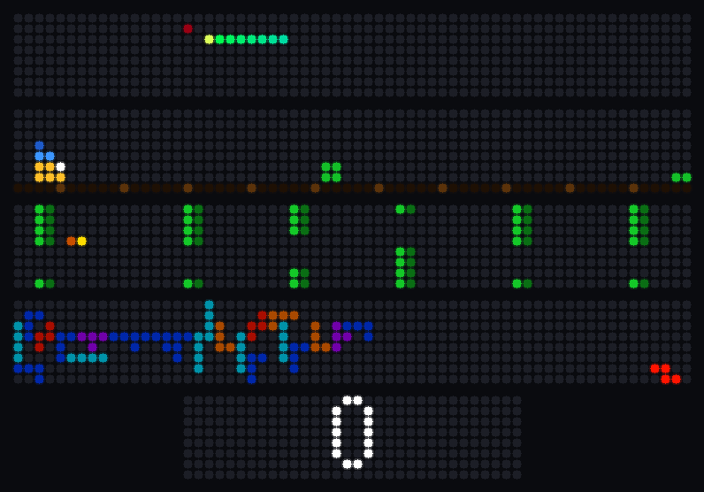

המשחק רץ על השעון עצמו, והטלפון משמש כשלט: בלשונית "משחקים" בוחרים משחק, ומופיעים חצים ולחצן A גדול. זה עובד גם ב-WiFi וגם ב-Bluetooth. לכל משחק בוחרים מהירות מ-1 (איטי) עד 5 (מהיר), ואם הוא מאיץ בהדרגה תוך כדי משחק: הנחש מאיץ עם כל אוכל, הדינוזאור והציפור עם הזמן, והטטריס כל 6 שורות. ההגדרה נשמרת לכל משחק בנפרד. בסוף כל משחק מוצג הניקוד, ובצבעי קשת עם "שיא!" כשנשבר השיא. השיאים נשמרים בזיכרון הבקר. אחרי דקה וחצי בלי לחיצות השעון חוזר לבד.

| משחק | בטלפון | בלחצני המגע |
|---|---|---|
| סנייק | החצים מכוונים. הקצוות מחוברים: יוצאים מצד אחד ונכנסים מהשני | 1 פונה שמאלה, 3 פונה ימינה |
| דינוזאור | A או ▲ קופץ מעל קקטוסים, ▼ (להחזיק) מתכופף מתחת לציפורים. הציפורים מגיעות מ-8 נקודות | 1 או 2 קופץ, 3 מתכופף |
| פלאפי | A מעיף את הציפור למעלה, בין הצינורות | כל לחצן |
| טטריס | לשוכב: החלקים נופלים מימין לשמאל. ▲▼ מזיזים, A מסובב, ◀ מפיל | 1 למעלה, 3 למטה, 2 מסובב, נגיעה ארוכה ב-2 מפילה |

בזמן משחק ב-WiFi השעון מפסיק לשדר Bluetooth, כי שניהם חולקים את אותו רדיו. כך לחיצה מגיעה בערך פי שניים מהר יותר (כ-80 מילישניות במקום 200).

## דף ההגדרות

הדף בעברית ומותאם לטלפון. הוא שמור בתוך הקושחה, ולכן עובד גם בלי אינטרנט. כל שינוי נשמר מיד, ובראש הדף מופיע "✓ נשמר" (או "לא נשמר · נסה שוב" אם החיבור נפל). בתיבת טקסט מופיע לחצן "שמור" כשמשנים אותה, ומסגרת השדה כתומה עד שהשינוי נשמר וירוקה אחרי.

<table>
<tr>
<td>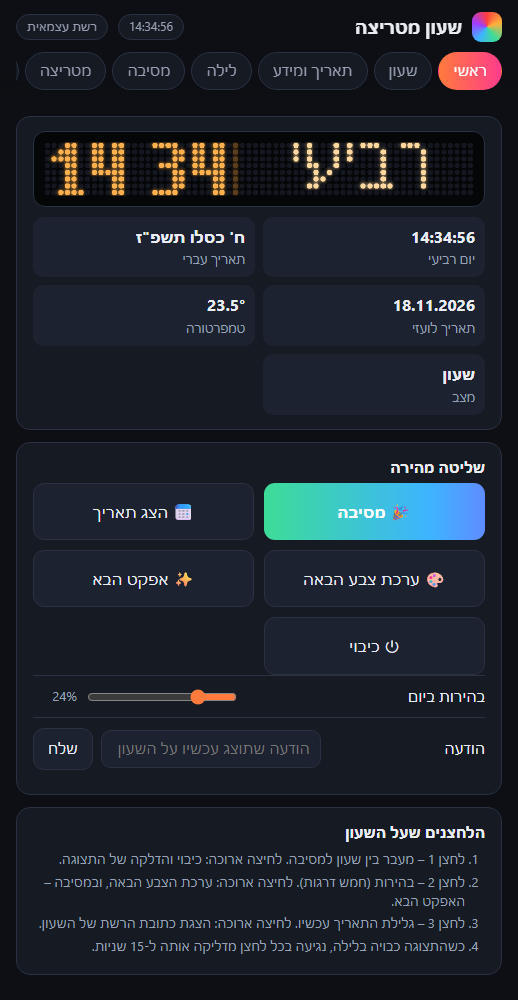</td>
<td>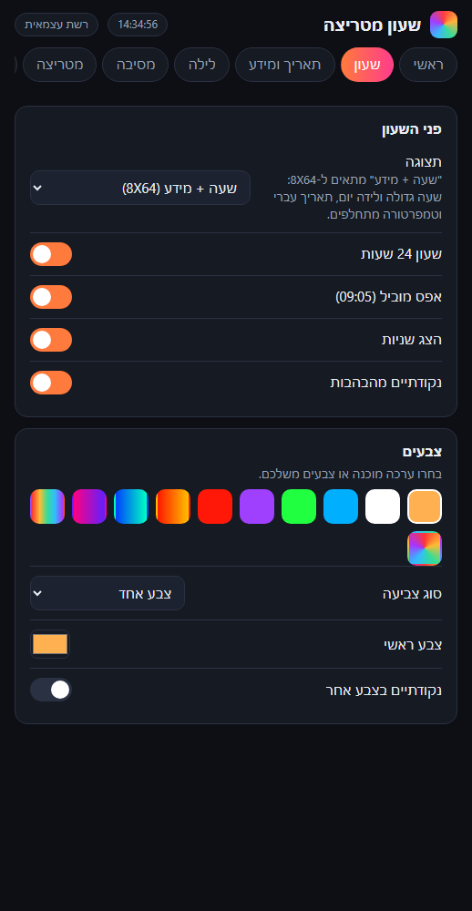</td>
<td>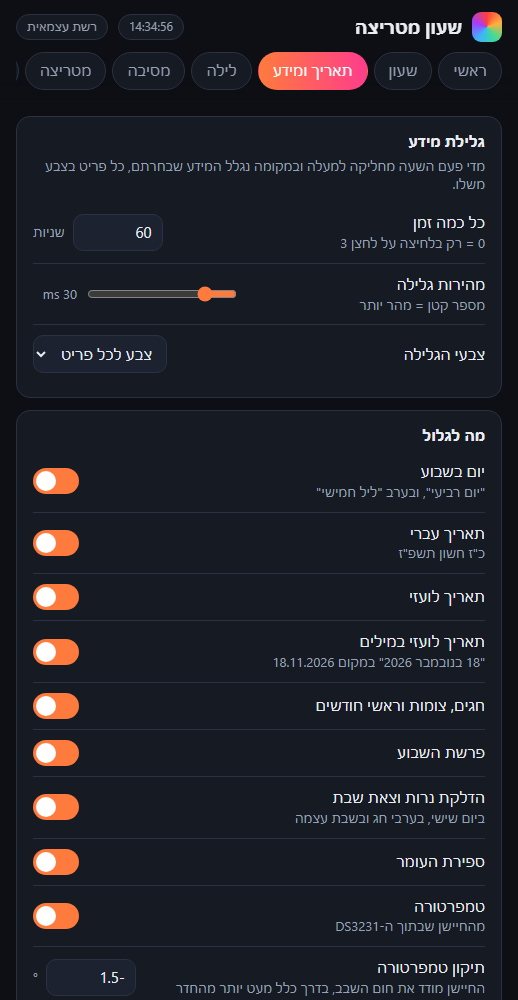</td>
</tr>
<tr>
<td>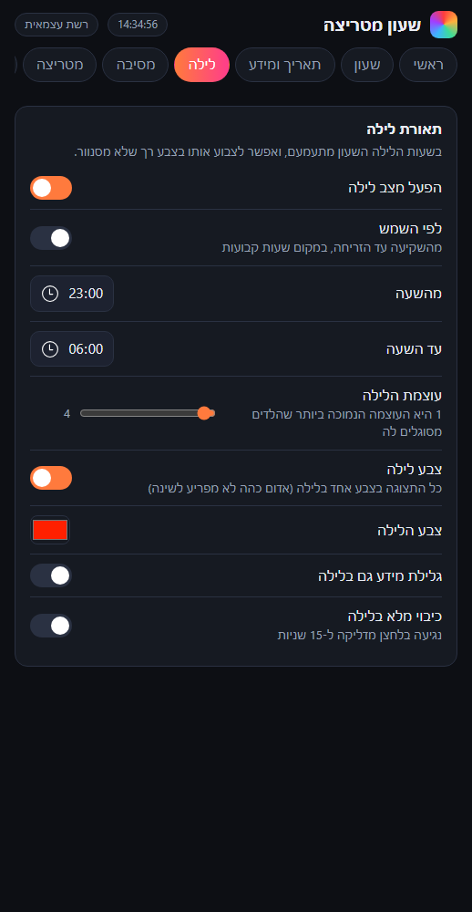</td>
<td>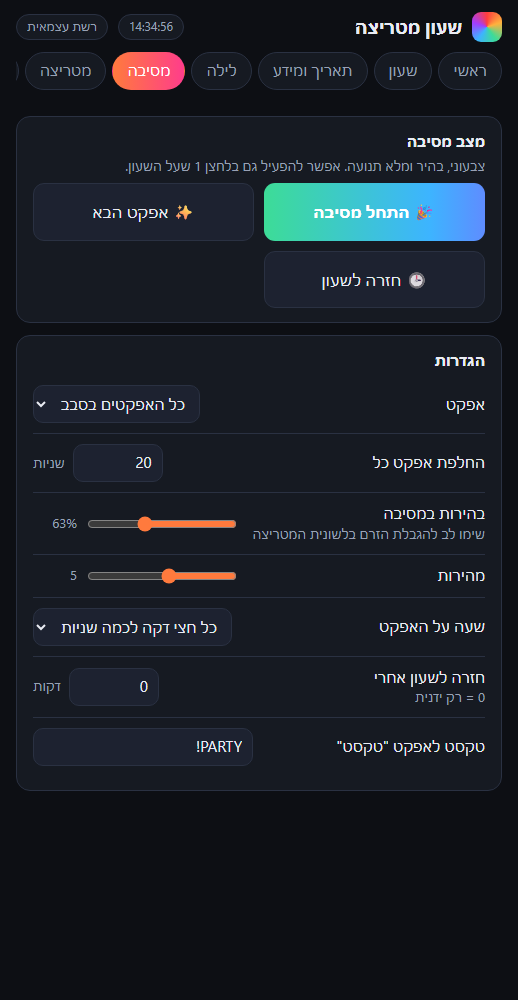</td>
<td>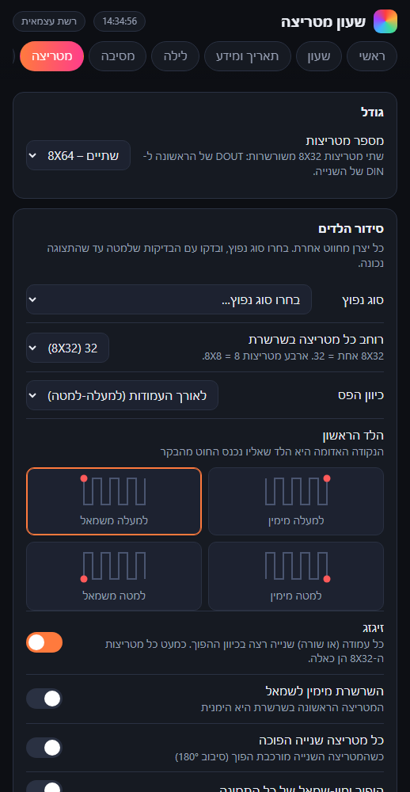</td>
</tr>
</table>

| לשונית | מה יש בה |
|---|---|
| ראשי | תצוגה חיה של הצג, תאריך וטמפרטורה, כפתורים מהירים, בהירות, ושליחת הודעה שתוצג מיד |
| שעון | סגנון השעה, 12/24, שניות, ערכות צבע וצבעים משלכם |
| תאריך ומידע | מה לגלול ובאיזה קצב, הודעה קבועה, עיר, ארץ ישראל או חוץ לארץ, דקות לכניסת שבת (הדלקת נרות), צאת שבת, מנהג הפרשות |
| לילה | שעות או שמש, עוצמה, צבע לילה, כיבוי מלא |
| מסיבה | אפקט או סבב, מהירות, בהירות, שעה על האפקט, חזרה אוטומטית |
| משחקים | בחירת משחק והשיא שלו, ושלט עם חצים ולחצן A |
| מטריצה | גודל, סידור הלדים, סדר צבעים, בדיקות, הגבלת זרם |
| שעה ורשת | כיוון שעה מהטלפון, אזור זמן, מצב עצמאי או רשת הבית, סיסמת המדבקה וסיסמה אחרת לרשת של השעון, Bluetooth |
| מערכת | שם השעון (בסריקת Bluetooth, ברשת ה-WiFi שלו ובראש הדף), גרסה, זיכרון, עדכון קושחה, גיבוי ושחזור, איפוס |

## אפליקציית Bluetooth

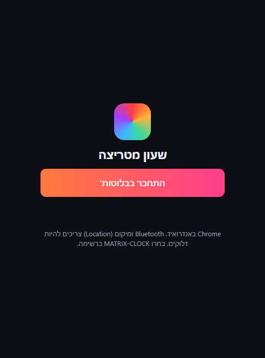

אותו דף ההגדרות פורסם גם ב-GitHub Pages, בכתובת מאובטחת (https). משם אפשר להתקין אותו כאפליקציה, והוא מדבר עם השעון ב-Bluetooth LE במקום ב-WiFi.

1. ב-Chrome באנדרואיד פותחים את <https://amir684.github.io/esp32-matrix-clock/>.
2. בתפריט בוחרים "התקן אפליקציה" (או "הוסף למסך הבית").
3. פותחים את האפליקציה, לוחצים "חפש את השעון" ובוחרים אותו ברשימה (MATRIX-CLOCK, או השם שנתתם לו).

**מדבקה לשעון:** [`docs/images/app-qr-sticker.png`](docs/images/app-qr-sticker.png) היא ברקוד (QR) של כתובת האפליקציה עם כיתוב, מוכנה להדפסה. ברוחב 3.6 ס"מ היא נסרקת בקלות, ולא כדאי להקטין מתחת ל-2 ס"מ. [`app-qr.png`](docs/images/app-qr.png) הוא הברקוד לבד. שניהם נוצרים מחדש על ידי `python tools/make_qr.py`.

אחרי ההתקנה האפליקציה עובדת גם בלי אינטרנט.

**סיסמת המדבקה:** כל שעון מגריל בהפעלה הראשונה סיסמה משלו לרשת ה-WiFi שלו, ושומר אותה בזיכרון נפרד, כך שגם איפוס להגדרות יצרן לא משנה אותה. רואים אותה בלשונית "שעה ורשת" באפליקציה. כשהשעון ברשת משלו, נגיעה ארוכה בלחצן 3 מציגה על הצג את שם הרשת, הסיסמה והכתובת. אפשר לקבוע סיסמה אחרת באפליקציה, ושמירה של שדה ריק מחזירה לסיסמת המדבקה.

**חיבור אוטומטי:** האפליקציה מתחברת לבד לשעון מהפעם הקודמת, ומציגה את "חפש את השעון" רק אם לא מצאה אותו תוך 8 שניות. ב-Chrome באנדרואיד זה דורש הגדרה אחת: ב-`chrome://flags` מפעילים את **Web Bluetooth new permissions backend** ומפעילים את Chrome מחדש. בלי ההגדרה הזאת בוחרים את השעון מהרשימה בכל פתיחה, והאפליקציה מציגה את ההוראות האלה על המסך.

**למה לא ישר מהשעון?** Chrome מאפשר Bluetooth ומאפשר להתקין דף כאפליקציה רק כשהדף מגיע בכתובת מאובטחת. השעון מגיש את הדף ב-http רגיל. לכן הדף שהשעון מגיש עובד ב-WiFi, וההעתק ב-GitHub עובד ב-Bluetooth. הקוד זהה, ושכבת התקשורת בוחרת לבד לפי הכתובת.

**מגבלות:**
- Safari באייפון לא תומך ב-Web Bluetooth. באייפון משתמשים בדף של השעון דרך WiFi.
- עדכון קושחה רק דרך WiFi.
- התצוגה החיה מתעדכנת לאט יותר מאשר ב-WiFi.
- אין צימוד עם קוד: כל מי שבטווח (כ-10 מטרים) ועם האפליקציה יכול להתחבר. אפשר לכבות את ה-Bluetooth בלשונית "שעה ורשת".

<br clear="left">

## סידור המטריצה

כל יצרן מחווט את הלדים אחרת. הקושחה ממפה את התמונה לכל סידור, לפי האפשרויות האלה:

| אפשרות | משמעות |
|---|---|
| רוחב כל מטריצה בשרשרת | 32 למטריצת 8×32. 8 לשרשרת של מטריצות 8×8 |
| כיוון הפס | לאורך העמודות (רוב מטריצות ה-8×32 הגמישות) או לאורך השורות |
| הלד הראשון | הפינה שבה נכנס החוט: למעלה או למטה, משמאל או מימין |
| זיגזג | כל עמודה (או שורה) שנייה רצה בכיוון ההפוך |
| השרשרת מימין לשמאל | המטריצה הראשונה בשרשרת היא הימנית |
| כל מטריצה שנייה הפוכה | מטריצה שהותקנה בסיבוב של 180° |
| היפוכים | ימין-שמאל ולמעלה-למטה של כל התמונה |
| סדר צבעים | GRB (WS2812B), RGB, BRG, RBG, GBR, BGR |

**שלוש בדיקות** בלשונית "מטריצה":

1. **שרשור:** הלדים נדלקים אחד אחרי השני לפי סדר החיווט, בלי שום מיפוי, והלד הראשון נשאר אדום. מכאן רואים את הפינה, את הכיוון ואם יש זיגזג.
2. **מיפוי:** אדום צריך להופיע למעלה משמאל, ירוק למעלה מימין, כחול למטה משמאל וצהוב למטה מימין. נקודה לבנה רצה משמאל לימין בשורה העליונה, והמספר 123 קריא.
3. **צבעים:** אדום, ירוק, כחול ולבן, כל אחד עם שמו. אם הצבעים מתחלפים, משנים את סדר הצבעים.

**הגבלת הזרם** מחושבת לכל תמונה. כשהתמונה מבקשת יותר ממה שהספק נותן, הבהירות יורדת אוטומטית.

## שעה ורשת

| מצב | מה קורה |
|---|---|
| עצמאי (ברירת המחדל) | השעון פותח רשת משלו בשם MATRIX-CLOCK, עם הסיסמה שעל המדבקה. השעה נשמרת ב-DS3231, ומכוונים אותה מהטלפון בלחיצה |
| רשת הבית | השעון מתחבר לרשת, לוקח שעה מהאינטרנט (NTP) וכותב אותה ל-DS3231. הכתובת מוצגת על השעון וזמינה גם בשם `matrixclock.local`. אם הרשת נעלמת ליותר מ-45 שניות, השעון פותח שוב את הרשת שלו |

בשני המצבים אזור הזמן כולל מעבר אוטומטי לשעון קיץ. ברירת המחדל היא ישראל.

עדכון קושחה: לשונית "מערכת", ובוחרים את `.pio/build/esp32doit-devkit-v1/firmware.bin`.

## מבנה הקוד

</div>

```
hebcal   zmanim
     \     /
      info  <---  settings  --->  matrix (map, SPI output, text, digits)
        |                           |
       ui  (faces, ticker, night, party, tests)  <--- effects, games
        |
   api (JSON)  <---  net (WiFi, web server, NTP, DS3231, OTA)
               <---  ble (Bluetooth LE, same API)
```

<div dir="rtl">

| קובץ | תפקיד |
|---|---|
| `src/matrix.*` | חוצץ התמונה, המיפוי לכל סוגי החיווט, סדר צבעים, הגבלת זרם, טקסט עברי מימין לשמאל, ספרות השעון, והשליחה ללדים |
| `src/ui.*` | פני השעון, גלילת המידע, הודעות, לילה, מסיבה, בדיקות, ערכות צבע |
| `src/effects.*` | 17 אפקטי המסיבה |
| `src/games.*` | סנייק, דינוזאור, פלאפי וטטריס, והשיאים |
| `src/info.*` | מה ידוע על היום: תאריך עברי ולועזי, חגים, פרשה, זמני שבת, עומר, טמפרטורה |
| `src/hebcal.*`, `src/zmanim.*` | הלוח העברי וזמני השמש, מתוך [luach-esp32-max7219](https://github.com/amir684/luach-esp32-max7219) |
| `src/api.*` | ממשק ה-JSON, בלי תלות בדרך שבה הגיעה הבקשה |
| `src/net.*` | WiFi, נקודת גישה ודף שבוי, mDNS, NTP, DS3231, שרת האינטרנט, עדכון קושחה |
| `src/ble.*` | שירות Bluetooth LE שמעביר בקשות לאותו API |
| `src/rtc.*` | מנהל DS3231 קטן: שעה ב-UTC וטמפרטורה |
| `src/bme.*` | מנהל BME280 / BMP280: טמפרטורה, לחות ולחץ אוויר |
| `src/buttons.*` | שלושת לחצני המגע: לחיצה קצרה וארוכה |
| `src/settings.*` | כל ההגדרות, שמורות כ-JSON בזיכרון הבקר (NVS) |
| `web/index.html` | דף ההגדרות והאפליקציה. קובץ אחד, בלי ספריות חיצוניות |
| `tools/embed_web.py` | רץ לפני כל בנייה. אורז את הדף לקושחה ומעתיק אותו ל-`docs/` בשביל GitHub Pages |
| `docs/` | האפליקציה (manifest, service worker, אייקון) ותמונות ה-README |

**למה SPI ולא FastLED או RMT?** WiFi ו-Bluetooth יחד ממלאים כמעט את כל זיכרון ה-IRAM של ה-ESP32. הדרייברים של FastLED ושל RMT מכניסים לשם קוד פסיקות ולא נכנסו. הלדים מוזנים לכן מחומרת ה-SPI: כל ביט של WS2812 הופך לארבעה ביטים של SPI בקצב 3.2MHz (`1000` או `1100`). התזמון מגיע מהחומרה, ובלי פסיקות. ארבעה ולא שלושה: הליבה שולחת את הנתונים בחתיכות של 64 בתים עם הפסקה קצרה ביניהן, ועם ארבעה ביטים כל חתיכה נגמרת בסוף ביט, כשהקו נמוך. עם שלושה, חתיכה נגמרה לפעמים באמצע פולס, הפולס התארך, 0 נקרא כ-1 והצבעים יצאו חיוורים. FastLED משמש עדיין לצבעים, לאפקטים ולחישוב הזרם.

## הממשק (API)

אותו ממשק עובד ב-HTTP וב-Bluetooth.

| נתיב | שיטה | מה הוא עושה |
|---|---|---|
| `/api/status` | GET | שעה, תאריכים, טמפרטורה, מצב, רשת, גרסה, רשימת האפקטים |
| `/api/settings` | GET / POST | כל ההגדרות. ב-POST מתעדכנים רק השדות שנשלחו |
| `/api/backup` | GET | ההגדרות כקובץ (בלי סיסמאות) |
| `/api/time` | POST | `{"epoch": ...}` מכוון את השעון ואת ה-DS3231 |
| `/api/action` | POST | `{"do": "party" \| "clock" \| "nextEffect" \| "ticker" \| "theme" \| "power" \| "notice" \| "testChain" \| "testMap" \| "testColors" \| "reboot" \| "factory"}` |
| `/api/action` | POST | משחקים: `{"do": "game", "game": 0..3}`, `{"do": "gameStop"}`, מהירות: `{"do": "gameSpeed", "game": 0..3, "level": 1..5, "ramp": true}`, ומקש: `{"do": "key", "k": "left" \| "right" \| "up" \| "down" \| "a", "s": 1/0, "r": 1}` (s = נלחץ או שוחרר, r = "עדיין לחוץ"). התשובה היא מצב המשחק |
| `/api/game` | GET | המשחק שעל הצג (1- = אין), הניקוד, האם נגמר, ולכל משחק שיא, מהירות והאם הוא מאיץ |
| `/api/frame` | GET | התמונה שעל הצג, 6 ספרות הקס לכל נקודה |
| `/api/scan` | GET | רשתות אלחוטיות בסביבה |
| `/update` | POST | העלאת קושחה (HTTP בלבד) |

**ב-Bluetooth:** יש שירות `c1a70001-5e2d-4b8e-9f3a-6d0b8e1c7a10` עם שני מאפיינים:
- `…0002` לכתיבת הבקשה.
- `…0003` להתראות התשובה.

כל חבילה היא `[id][flags][data]`, כאשר flags 1 מסמן את החבילה הראשונה ו-2 את האחרונה.
- תוכן הבקשה: `METHOD /path\n` ואחריו הגוף.
- תוכן התשובה: `קוד\n` ואחריו ה-JSON.

## כלים ובדיקות

| כלי | מה הוא עושה |
|---|---|
| `tools/sim/run.ps1` | מקמפל את קוד התצוגה האמיתי (matrix, ui, info, hebcal, zmanim) למחשב, ומחליף את Arduino ו-FastLED בתחליפים קטנים. בודק את מיפוי הלדים לכל 1,536 צירופי האפשרויות דרך זרם הביטים של ה-SPI, ומצייר את כל פני השעון ואת הגלילה לתמונות. בוטים קטנים משחקים בכל משחק דרך אותם מקשים ולפי מה שעל המסך, ואחר כך מקשים אקראיים במשך 3 דקות לכל משחק. משתמש בקומפיילר MinGW ש-PlatformIO מתקין |
| `tools/webtest/mock_server.py` | מגיש את הדף מול שעון מדומה. `/?ble&fakeble` מריץ את האפליקציה מול מכשיר Bluetooth מדומה (`fake_ble.js`), שמדבר באותו פרוטוקול חבילות |

## מה נבדק ומה לא

| נבדק | איך |
|---|---|
| הקושחה נבנית | PlatformIO, pioarduino 55.3 (Arduino core 3.3.13). 1.47MB מתוך 6.25MB לכל מקום קושחה, ו-2KB פנויים ב-IRAM |
| על השעון עצמו | 8×32, דרך WiFi: הצבעים והתזמון של הלדים, עדכון קושחה מהדפדפן, ההגדרות, זמני השבת, המשחקים דרך ה-API, וחיבור טלפון ב-Bluetooth |
| BME280 | על לוח 4MB: מזוהה, וקריאות יציבות של טמפרטורה, לחות ולחץ אוויר |
| המשחקים | בסימולטור: בוטים משחקים בכל ארבעת המשחקים ב-8×32 וב-8×64, ואחר כך מקשים אקראיים |
| מיפוי הלדים | כל צירופי האפשרויות, דרך זרם הביטים האמיתי |
| פני השעון, הגלילה, הלוח העברי | הקוד האמיתי רץ על המחשב (התמונות שלמעלה) |
| דף ההגדרות | בדפדפן, מול שעון מדומה |
| שכבת ה-Bluetooth בדף | מול מכשיר מדומה: חיבור, בקשות, תשובות ארוכות שמחולקות לחבילות, ושליחה בעברית שמחולקת לכמה חבילות |

**עוד לא נבדק על חומרה אמיתית:**
- אפקטי המסיבה
- 8×64
- משחק אמיתי מהטלפון, והחיבור האוטומטי ב-Bluetooth
- הלחצנים וה-DS3231

</div>
